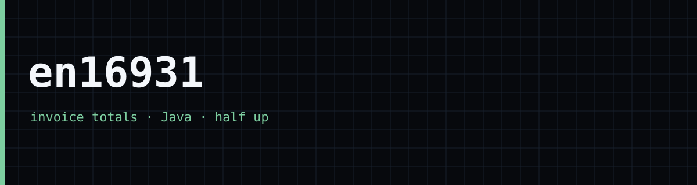

# en16931

Invoice totals in Java, using the EN 16931 equations. A line, a tax amount, or a payable that does not match is not written, and a file that was edited afterwards does not parse.

JDK 17. No dependencies. Nothing is sent to a tax authority.

From 1 January 2027 a German business with prior-year turnover above €800,000 has to issue a structured invoice for domestic B2B sales. A PDF does not count. France and Belgium are already in that regime. This library is the arithmetic those invoices fail on. It is not XRechnung, not ZUGFeRD, and not a Peppol document. The customization id is `urn:vantacorehq:invoice-totals:1` so the file is not mistaken for a cleared invoice.

## Rules that are checked

- BR-CO-10: the line extension is the sum of the line nets.
- BR-CO-13: the total without VAT is the line extension minus a document allowance. Document charges are rejected.
- BR-CO-15: the total with VAT is that net plus the VAT.
- BR-CO-16: the payable is the total with VAT minus the prepaid amount. Rounding is zero.
- VAT for a category is the category base times the rate, rounded half up. Three lines of €0.03 at 19% are taxed as €0.09, which is €0.02, not three times €0.01.

Categories are `S`, `Z`, and `E`. `Z` and `E` are 0%. Quantity is a decimal of at most four places. The unit code written is `C62`.

## Run

```bash
make test
```

`make test` prints `en16931: 34 checks passed`.

## License

MIT.
